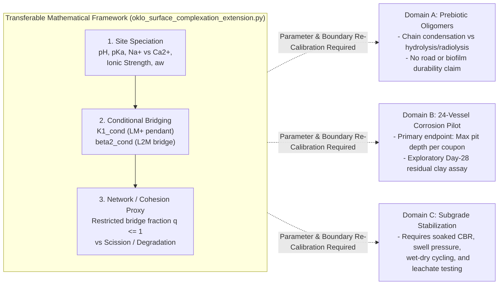

# Epistemic Synthesis: Transferring the Organo-Mineral Modeling Architecture to Lower-Carbon Soil Stabilization

> [!IMPORTANT]
> **Core Principle: Transfer the Mathematical Architecture, Not the Parameters or Performance Claims**
> The critique in your pasted review aligns directly with the epistemic guardrails in your existing codebase ([`oklo_surface_complexation_extension.md`](file:///Users/aurascoper/Downloads/oklo_surface_complexation_extension.md), [`oklo_equifinality_claim_audit.md`](file:///Users/aurascoper/Downloads/oklo_equifinality_claim_audit.md), and Slides 8 to 17 of [`Clay_Microbes_and_Metal_17_Slides_Inferred_Extension.pdf`](file:///Users/aurascoper/Downloads/Clay_Microbes_and_Metal_17_Slides_Inferred_Extension.pdf)):
> 1. **Prebiotic oligomers** (Oklo cyclic wetting-drying condensation vs. radiolytic scission),
> 2. **Biofilm EPS at a clay-metal corrosion interface** (the 24-vessel pilot with Ellen and Andrew), and
> 3. **Engineered biopolymer soil stabilization** (subgrade cohesion and wet-dry durability)
>
> share a transferable **forward mathematical structure** (site protonation -> conditional cation-ligand speciation -> effective inter-chain/inter-platelet bridge proxy -> bond formation vs. degradation), but they have **non-transferable chemistry, parameters, and engineering acceptance criteria**.

---

## 1. Ready-to-Use Backup Slide (`Slide 18 / 18`, 1920x1080 HD)

This backup slide matches the exact visual layout, palette, and epistemic framing of Slides 8 to 17 in [`Clay_Microbes_and_Metal_17_Slides_Inferred_Extension.pdf`](file:///Users/aurascoper/Downloads/Clay_Microbes_and_Metal_17_Slides_Inferred_Extension.pdf) (also saved to [`/Users/aurascoper/Downloads/Slide_18_Optional_Backup_Soil_Stabilization.png`](file:///Users/aurascoper/Downloads/Slide_18_Optional_Backup_Soil_Stabilization.png)):

---

## 2. Three-Domain Separation Matrix (What Transfers vs. What Does Not)

| Modeling Layer in [`oklo_surface_complexation_extension.py`](file:///Users/aurascoper/Downloads/oklo_surface_complexation_extension.py) | Domain A: Prebiotic Oligomers (Oklo 3D/4D Compartment Model) | Domain B: Clay-EPS-Metal Corrosion Pilot (Slides 8 to 17) | Domain C: Lower-Carbon Soil Stabilization (Optional Future Phase) |
| :--- | :--- | :--- | :--- |
| **1. Mineral & Water Chemistry** | Hydrothermal geyser pulse (`27 to 532 C`), hydration saturation (`0.02 to 0.93`), radiolytic $\text{H}_2$ (`0 to 6.74 mmol/L`) | Montmorillonite exchange state ($\text{Na}^+$ vs. $\text{Ca}^{2+}$), baseline $d_{001}$, water activity $a_w$, $\text{pH}/\text{Eh}$ | Native expansive or lateritic soil mineralogy, compaction density, field moisture regime, porewater ionic strength |
| **2. Ligand & Bridging Equilibria (`K1_cond`, `beta2_cond`)** | Candidate carboxylate/phosphate site protonation (`deprotonated_site_fraction`) and divalent metal complexation (`solve_monoprotic_divalent_speciation`) | $\text{Ca}^{2+}$-mediated EPS retention (`H4` on Slide 14) vs. electrostatic screening (`Mode 1`) | **Must separate two distinct mechanisms:** (a) $\text{Ca}^{2+}$-biopolymer bridging (`>OCa+` / `L2M`) vs. (b) MICP/EICP $\text{CaCO}_3$ mineral precipitation (which carries ureolytic $\text{NH}_4^+$ by-products and uniformity limits) |
| **3. Network Integrity vs. Degradation (`q <= 1`)** | `restricted_stockmayer_q_proxy` balanced against free and polymer-bound Fenton radiolytic scission (`split_fenton_scission_yield`) | Biofilm matrix retention and local $\text{Fe}/\text{S}$ cycling at the coupon interface | Resistance of clay-biopolymer matrix to wet-season slaking, cyclic wetting-drying, and microbial biodegradation |
| **4. Primary Empirical Endpoint** | Oligomer yield index (`umol/L`) and critical gelation ceiling | **Maximum pit depth per coupon** (Slide 15, $n = 4$ vessels/cell) | **Soaked CBR, swell pressure, standardized UCS, wet-dry durability, and leachate chemistry** |

---

## 3. Side-by-Side Audit & Correction of the Four Overclaims

| Topic & Source Anchor | Overclaim in Earlier Road-Stabilization Draft | Corrected, Epistemically Bounded Formulation |
| :--- | :--- | :--- |
| **1. $\text{Ca}^{2+}$ Exchange & Swelling** (`Ferrage et al. 2005`, Slide 3) | *"Replacing monovalent $\text{Na}^+$ with divalent $\text{Ca}^{2+}$ arrests osmotic swelling and caps the interlayer near the $2\text{W}$ ($\approx 15.2\text{ \AA}$) state."* | **Bounded Statement:** At `40% RH`, `Ferrage et al. (2005)` measured $\text{Na}$-montmorillonite near `12.5 A` (`1W`) and $\text{Ca}$-montmorillonite near `15.2 A` (`2W`), and $\text{Ca}$-exchanged smectites generally resist the unconstrained osmotic swelling characteristic of $\text{Na}$-smectites. However, $d_{001}$ depends on RH, solution chemistry, and layer charge; a single $d_{001}$ value at `40% RH` does not prove subgrade stability under full saturation and traffic loading. |
| **2. EPS Intercalation & $\text{Ca}^{2+}$ Bridging** (`Alimova et al. 2009`; `Xiong et al. 2022`, Slide 7) | *"Turns loose clay into a cross-linked organo-mineral hydrogel... raising UCS to `2 to 6 MPa` and eliminating road dust."* | **Bounded Statement:** `Alimova et al. (2009)` measured $d_{001}$ shifts (`1.50 -> 1.26 -> 1.84 nm`) in **hectorite** with *P. syringae*, and `Xiong et al. (2022)` measured higher biofilm biomass and thickness under `64 mM Ca2+` **without clay**. These observations motivate testing whether $\text{Ca}^{2+}$ and EPS interact in montmorillonite (`Hypothesis H4`), but they do not establish a field road-stabilization recipe. |
| **3. Microbial $\text{Fe(III)}$ Reduction** (`Kim et al. 2004`; `Stucki & Kostka 2006`, Slide 6) | *"Room-Temperature Biological Clay Locking... permanently lowering swelling pressure in every iron-bearing smectite tested [for black cotton subgrades]."* | **Bounded Statement:** `Kim et al. (2004)` and `Stucki & Kostka (2006)` showed that microbial reduction of structural $\text{Fe(III)}$ can promote smectite-to-illite reactions and reduce swelling pressure in tested iron-bearing smectites under controlled laboratory conditions (`14 days`, room temperature, with $\text{K}^+$). Whether such treatment achieves permanent or uniform stabilization in field vertisols remains an untested engineering question. |
| **4. Mechanical Performance Numbers & Assay Labels** (`2 to 6 MPa` UCS, $I_{\text{slake}} > 0.7$) | Presenting `2 to 6 MPa` UCS as an expected outcome and calling a `3 mm` plunger test on a `15 mm` residual clay puck *"Unconfined Compressive Strength (UCS)"*. | **Bounded Statement:** Literature UCS ranges (`2 to 6 MPa` at `0.5 to 1.5 wt%` biopolymer) are study-specific benchmarks for engineered soil mixes, not forecasts for post-exposure corrosion microcosm sediment. In the Day-28 residual-clay add-on, call the small-plunger readout **penetration resistance** (not UCS), and treat **24-hour immersion-retained mass fraction ($I_{\text{slake}}$)** as an exploratory pilot discriminator rather than a road-engineering certification standard. |

---

## 4. Corrected Day-28 Exploratory Residual-Clay Protocol (Drop-In Text for Ellen & Andrew)

Use the wording below if you bring this up as an optional secondary readout on the waste clay from the 16 clay-bearing vessels:

### Exploratory Secondary Assay on Day-28 Residual Clay (Zero Interference with Coupon Endpoints)

- **Scope & Protection of Primary Endpoint (Slide 12 & Slide 15):**
  - **Maximum pit depth per coupon** ($n = 4$ independent vessels per cell across the 24 vessels) remains the sole preselected primary endpoint.
  - Only after Day-28 coupon removal, blinded pit mapping, Raman, SEM/EDS, porewater chemistry, and the milligram-scale XRD aliquot ($d_{001}$) are completed, the leftover clay sediment from the 16 montmorillonite vessels (`4 Na-Live`, `4 Na-Sterile`, `4 Ca-Live`, `4 Ca-Sterile`) is molded into standardized mini-pucks (contingent on consistent post-harvest solid mass across vessels).

- **Three Exploratory Bench Readouts on Residual Sediment:**
  1. **Volumetric / Linear Drying Shrinkage ($\varepsilon_{\text{shrink}}$ at `40% RH`):** Tests whether live BSL-1 biofilm exposure and exchange state ($\text{Na}^+$ vs. $\text{Ca}^{2+}$) alter desiccation shrinkage and cracking relative to sterile controls.
  2. **Flat-Plunger Penetration Resistance (kPa):** Measures resistance to `2 mm` indentation on the dried residual puck. Reported strictly as **penetration resistance** (not standardized UCS, which requires ASTM-compliant aspect ratios and specimen geometry).
  3. **24-Hour Immersion-Retained Mass Fraction ($I_{\text{slake}} = m_{\text{retained}} / m_{\text{initial}}$):** Tests whether any observed dry cohesion survives re-wetting or disperses via osmotic swelling. Any threshold (such as $I_{\text{slake}} > 0.7$) is treated strictly as a **predeclared exploratory pilot comparison rule** across the $2 \times 2$ clay factorial (`Ca-Live - Ca-Sterile` vs. `Na-Live - Na-Sterile`, aligning with `Hypothesis H4` on Slide 14), not as a civil-engineering road acceptance standard.

- **Meeting Pitch Sentence for Ellen and Andrew:**
  > *"We do not claim to have a biological road stabilizer. We have a falsifiable modeling and experimental framework for testing how clay mineralogy, exchangeable cations (`Na+` vs. `Ca2+`), and biopolymers govern organo-mineral cohesion and interface chemistry; a low-cost penetration-resistance and slake check on the Day-28 waste clay lets us see whether `Hypothesis H4` produces a measurable mechanical signal before anyone proposes a dedicated soil-stabilization study."*
